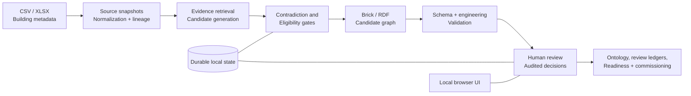

# Building Ontology Intelligence Engine

**Evidence-first building metadata → auditable Brick/RDF knowledge graphs.**

A Python application that transforms building automation metadata—equipment lists, point schedules, and documented connections—into structured [Brick Schema](https://brickschema.org/) knowledge graphs with traceable sources, explicit uncertainty, engineering checks, and human review.

The public demonstration is built around **synthetic building datasets**. It is a software-engineering example, not a claim that a model reconstructed any particular real building or that its suggested relationships have been field-verified.

## What the system does

- **Source-preserving ingestion:** Supports configurable CSV/XLSX input mappings, inventory, normalization, source hashes, and row-level provenance.
- **Candidate generation and evidence gating:** Builds potential classes and relationships while keeping suggestions distinct from accepted graph assertions; optional external inference requires explicit authorization.
- **Contradiction handling:** Records competing or unsupported relationship claims instead of silently treating an inference as fact.
- **Deterministic graph output:** Produces auditable RDF/Turtle artifacts mapped to the Brick vocabulary.
- **Semantic and engineering validation:** Runs pinned Brick 1.4.4 SHACL checks and bounded, physics-informed screening; unavailable evidence is reported as such rather than invented.
- **Review and reproducibility:** Supports human decisions, review provenance, replay/recovery checks, read-only inspection, and derived commissioning/readiness reports.
- **Local interface:** A browser-based inspection and guided workflow served on localhost.

## Architecture



A candidate or "supported inference" is **not** a physically verified building connection. The system distinguishes documentary support, contradictions, missing operational evidence, and unknowns.

## Quick start: fully offline synthetic example

Python **3.9 or later** is required. Dependency installation requires internet access; the demo itself uses the deterministic fixture provider and does **not** transmit data to an LLM.

```bash
python3 -m venv .venv
source .venv/bin/activate
python -m pip install --upgrade pip
python -m pip install -e '.[dev]'

python -m ontology_engine run \
  --input fixtures/demo_building \
  --output output/demo \
  --llm-provider fixture

python -m ontology_engine validate \
  --graph output/demo/ontology.ttl \
  --output output/demo-validation.json
```

The run writes a graph and supporting source, inference, validation, and review artifacts beneath `output/demo/`. The separate `validate` command performs an offline pinned Brick/SHACL check, which can take noticeable time on some machines.

## Browser interface

Start the authenticated local server:

```bash
python -m ontology_engine web --data-root output/local_browser --runs-root output
```

The application listens on localhost (default port **8765**) and prompts for a **16–256 character** local login password. Open `http://127.0.0.1:8765` in your browser. The `--runs-root output` option makes the earlier synthetic `output/demo` run visible in the local interface.

Use the included synthetic demo when exploring the pipeline. Do not submit confidential building records or use external inference without appropriate authorization.

## Tests and verification

```bash
python -m pytest -q --tb=short --disable-warnings
```

**Verified local result:** **367 passed**, exit code **0**, in **426.72 seconds** on macOS / Python **3.9.6** (November 16, 2026), from a fresh exported candidate and virtual environment. This is a locally observed result, **not** a CI claim or a benchmark of production workload performance.

The suite covers ingestion, source integrity, candidate inference, evidence handling, graph constraints, security boundaries, review workflows, commissioning, readiness, local APIs, and recovery behavior. Full validation tests can be slow because the project uses the pinned Brick ontology and SHACL processing.

## Project structure

| Path | Role |
| --- | --- |
| `ontology_engine/` | Pipeline, inference, validation, review, reporting and local UI |
| `ontology_engine/resources/` | Pinned Brick ontology, validation resources, required upstream notice |
| `fixtures/` | Independently authored synthetic development and regression fixtures |
| `tests/` | Unit, integration, security and regression tests |
| `configs/` | Demonstration input mapping configurations |
| `datasets/public_sources.json` | Registry of source references and their declared provenance/license status |

## Security and scope

- No connection to live building control systems and no automatic control actions.
- No real-world fault-detection accuracy or field verification is claimed.
- Public synthetic fixtures do not establish the provenance of any external dataset.
- External AI processing is **opt-in** and must be authorized for each relevant dataset; the fixture provider is not an external model.
- No real API keys, client-building data, private submission packages, or private Git history belong in this public demonstration.

## Attribution and licensing

The bundled **Brick 1.4.4** ontology is a separate third-party work whose redistribution terms and attribution are preserved in `ontology_engine/resources/Brick-LICENSE.txt`. Dependencies have their own licenses. A project-level license for original application code should be added only after confirming the necessary ownership and distribution permissions.

## Status

**Public demonstration:** The exported application installed successfully and passed all **367 automated tests** in a local Python 3.9 environment. The release export's targeted scanner and an independent Gitleaks directory scan reported **zero blocking findings**. These checks do not establish ownership, redistribution rights, or security guarantees; only synthetic demonstrations are intended for this repository.
